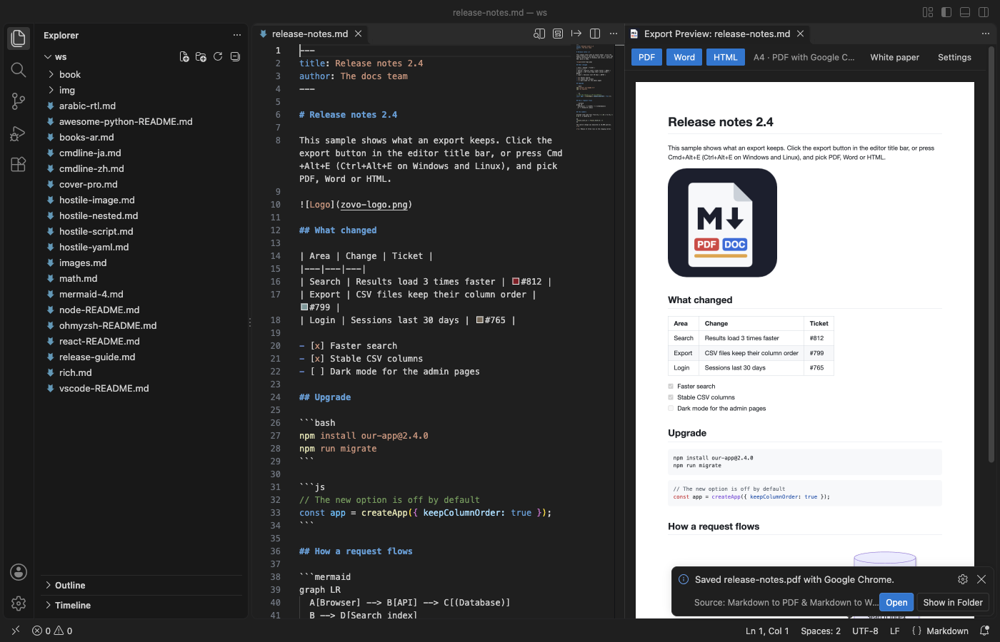
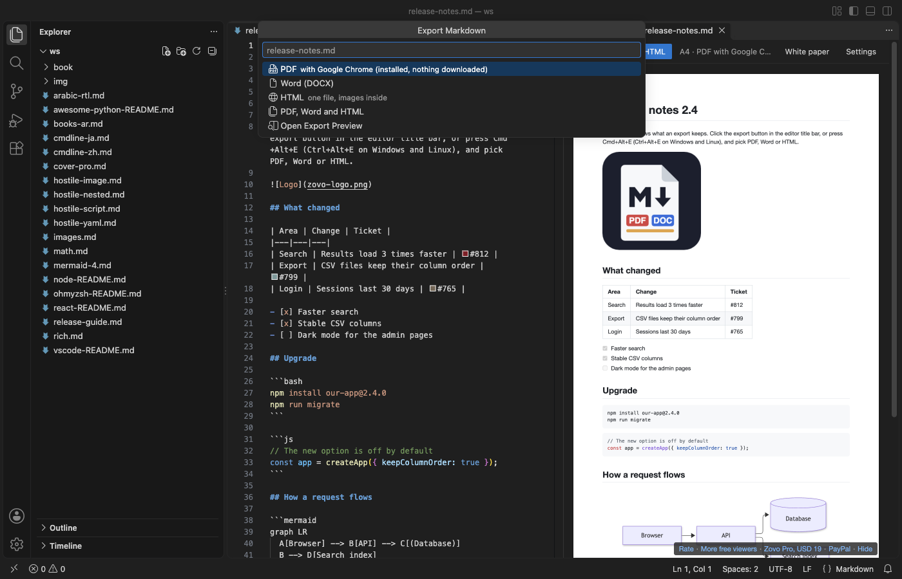
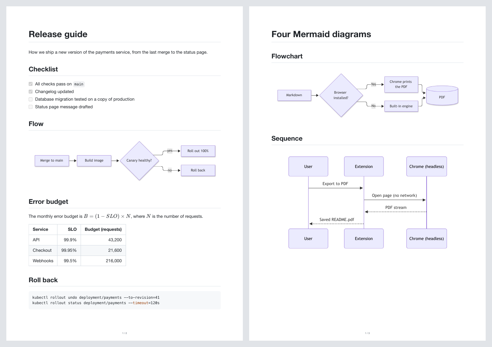
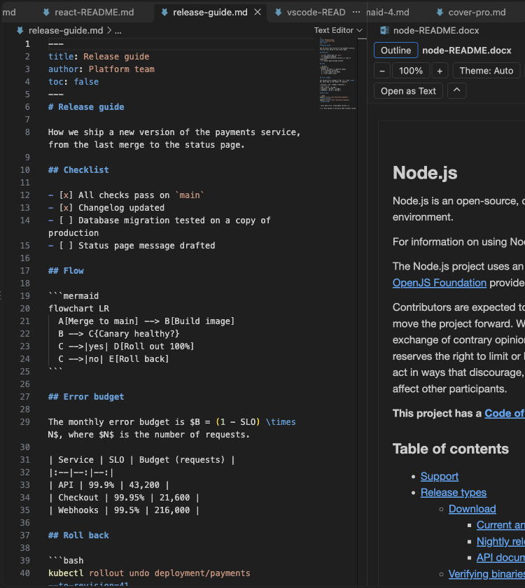

# Markdown to PDF & Markdown to Word (DOCX, HTML Export, No Chromium Download)

Markdown to PDF, Markdown to Word (.docx) and Markdown to HTML, right in VS Code. PDFs are printed by the Chrome, Edge or Brave already on your computer, so there is nothing to download. Free, no sign-in, works offline.



- Nothing to download. No Chromium, no setup. Without a browser, a built-in engine still makes the PDF.
- Word that behaves like Word. Headings use Word's own Heading 1 to 6 styles, so the Navigation pane and Word's table of contents work. Real numbered lists, tables, footnotes and code with colours.
- Looks like the Markdown preview. GitHub-style pages with code colours, KaTeX math, Mermaid diagrams, task lists and footnotes.
- No network. Remote images stay off until you turn them on. Scripts in the Markdown never run.

## Export

Open a Markdown file and click the export button in the editor title bar, or press `Cmd+Alt+E` (macOS) or `Ctrl+Alt+E`. Pick PDF, Word (DOCX), HTML or all three. The file is saved next to the Markdown file.

You can also right-click a Markdown file in the Explorer (Markdown Export menu), select several files, right-click a folder (Export Every Markdown File in a Folder), or select text and choose Export Selection. From the Command Palette, the folder export lists your workspace folders and every folder that holds Markdown files, so you do not have to browse for it.

New to it? Get Started (in the Command Palette: Markdown Export: Get Started) opens a sample with a table, code, a formula and a Mermaid diagram to try the export on.



## What you get

| | PDF (your browser) | PDF (built-in) | Word (.docx) | HTML |
|---|---|---|---|---|
| Headings, lists, tables, quotes, links | yes | yes | yes, Word styles | yes |
| Code colours | yes | yes | yes | yes |
| Images (PNG, JPEG, GIF, SVG, WebP) | yes | PNG, JPEG | yes (SVG and WebP need a browser) | inlined, one file |
| KaTeX math | yes | as TeX text | as pictures (needs a browser) | yes |
| Mermaid diagrams | yes | as code | as pictures (needs a browser) | as SVG (needs a browser) |
| Footnotes, task lists | yes | yes | yes, real Word footnotes | yes |
| Table of contents | clickable | with page numbers | clickable | clickable |
| Header, footer, page numbers | yes | yes | yes | no |
| PDF bookmarks (outline) | yes | no | n/a | n/a |
| CJK and right-to-left text | yes | with a system font | yes | yes |



The Word file keeps real heading styles, so its outline works in Word and in any DOCX viewer:



## Page setup

Settings apply to every file. Front matter changes them for one file:

```yaml
---
title: Quarterly report
pageSize: Letter          # A4, Letter, Legal, A3, A5, B5, Tabloid
landscape: false
margin: 20mm 15mm         # mm, cm, in, pt or px
header: "{title}"
footer: "Page {page} of {pages}"
toc: true
---
```

Put `<!-- pagebreak -->` (or `\newpage`) on its own line to start a new page. Open Export Preview shows the document on a sheet with your page size and margins before you export.

## Where PDFs come from

1. A browser you already have. Google Chrome, Microsoft Edge, Brave, Chromium or Vivaldi, found in the usual install folders, or the path in `markdownExport.browserPath`. It runs hidden with a new temporary profile that is deleted afterwards. Your own browser profile, tabs and logins are never touched.
2. The built-in engine (pdfmake, inside the extension), when no browser is found or the browser fails. The layout is simpler: Mermaid diagrams show as code and formulas as TeX.

Run Markdown Export: Which PDF Engine Is Used? to see which one you have.

## Why this one

The most-installed Markdown PDF extension has 4.3 million installs. Its users report these problems. This extension was built to avoid them:

| Reported problem | Links | Here |
|---|---|---|
| It downloads Chromium before the first PDF ("hundreds of megabytes for a simple pdf converter"). Chrome for Testing 157 is 197 to 211 MB per download. | [review, Feb 2026](https://marketplace.visualstudio.com/items?itemName=yzane.markdown-pdf&ssr=false#review-details), [#80 Failed to download Chromium](https://github.com/yzane/vscode-markdown-pdf/issues/80), [#441 download behind a proxy](https://github.com/yzane/vscode-markdown-pdf/issues/441), [#445 incomplete download](https://github.com/yzane/vscode-markdown-pdf/issues/445) | Downloads nothing. The whole extension is a 3.4 MB download. |
| "Failed to launch the browser process", so no PDF at all. | [#436](https://github.com/yzane/vscode-markdown-pdf/issues/436), [#451](https://github.com/yzane/vscode-markdown-pdf/issues/451), [#461](https://github.com/yzane/vscode-markdown-pdf/issues/461), [review, Jun 2026](https://marketplace.visualstudio.com/items?itemName=yzane.markdown-pdf&ssr=false#review-details) | Uses your installed browser with a fresh profile. If it cannot start, the built-in engine makes the PDF and the message says so. |
| "Silently fails." | [review, May 2026](https://marketplace.visualstudio.com/items?itemName=yzane.markdown-pdf&ssr=false#review-details) | Every export ends with a message: the saved file, or what went wrong. Details go to the Markdown Export output panel. |
| No Word export. | [#439](https://github.com/yzane/vscode-markdown-pdf/issues/439) | Word (.docx) with real Word styles. |
| Brave is not detected. | [#446](https://github.com/yzane/vscode-markdown-pdf/issues/446) | Brave, Edge, Chrome, Chromium and Vivaldi are found. |
| No preview of page size, margins, header and footer. | [#468](https://github.com/yzane/vscode-markdown-pdf/issues/468) | Open Export Preview. |

This extension is a separate project by Zovo. It is not made by, and does not replace, any other publisher's extension.

## Large files

Tested in VS Code on an Apple Silicon Mac with a 5 MB Markdown file: the PDF (2,774 pages) took 15 seconds with Chrome, the Word file 4 seconds. Word exports and built-in PDF exports of very large files run in a worker thread with a memory cap, so VS Code stays responsive and the memory is freed afterwards. Files over `markdownExport.maxFileMB` (50 MB) ask first. The preview shows the first 200 KB of very large files and refreshes on save. PDF bookmarks are left out for very large files, because they double the file size.

## Privacy and safety

- No telemetry, no account, no ads.
- No network request while you export, unless you turn on `markdownExport.allowRemoteImages`. Three locks keep it that way: a page security policy, a blocked proxy in the hidden browser, and a request filter.
- `<script>` tags, `onclick`-style attributes and `javascript:` links in the Markdown are removed, and the page policy blocks any script that is left. The exported HTML file carries a policy that runs no scripts.
- The only call the extension can make is one question to GitHub, when you choose I already paid: unlock with GitHub Sponsors.

## Free and Pro

Every export to PDF, Word and HTML is free: one file, a selection, several files or a whole folder, with the preview, table of contents, header, footer, math and Mermaid.

Zovo Pro adds three tools for longer documents. Each has 3 free tries on your computer:

- Merge a folder into one PDF, each file on a new page, with one outline.
- Word template. Word exports take the fonts, colours and spacing of your own .docx or .dotx (`markdownExport.docxTemplate`).
- Cover page from the front matter title, subtitle, author and date (`cover: true`).

A try is used only when a file was saved with the tool. One export run uses one try per tool, even for a whole folder. If you cancel, or the export fails, the try stays. After the third try, the next use of that tool shows what Zovo Pro is, once, and the export still runs without the Pro part if you cancel. Nothing about Pro appears on its own. Set `markdownExport.showProFeatures` to `false` to hide the Pro command and the Zovo Pro commands.

Zovo Pro is USD 19 once on GitHub Sponsors (the "$19 one time" tier: https://github.com/sponsors/theluckystrike/sponsorships?tier_id=679878), or by PayPal (Zovo Pro: Pay for Zovo Pro with PayPal). It turns on the Pro tools in every Zovo VS Code extension. If you bought that tier, or sponsor monthly with USD 10 or more, run Zovo Pro: I already paid: unlock with GitHub Sponsors.

## Settings

| Setting | Default | What it does |
|---|---|---|
| `markdownExport.pdfEngine` | `auto` | `auto`, `browser` or `builtin` |
| `markdownExport.browserPath` | empty | A Chrome, Edge, Brave or Chromium program to use |
| `markdownExport.outputFolder` | empty | Where files go. Empty: next to the Markdown file |
| `markdownExport.pageSize` | `A4` | A4, Letter, Legal, A3, A5, B5, Tabloid |
| `markdownExport.margin` | `20mm` | One to four values |
| `markdownExport.header` / `footer` | empty / `{page} / {pages}` | `{title}`, `{date}`, `{page}`, `{pages}` |
| `markdownExport.toc` | `false` | Table of contents from headings 1 to 3 |
| `markdownExport.allowRemoteImages` | `false` | Load http(s) images |
| `markdownExport.htmlTheme` | `auto` | HTML follows the reader's light or dark setting |
| `markdownExport.openAfterExport` | `notify` | `notify`, `open` or `none` |
| `markdownExport.showProFeatures` | `true` | `false` hides Merge a Folder into One PDF and the Zovo Pro commands |

## Works in

VS Code 1.90 or later, Cursor, Windsurf and VSCodium, on macOS, Windows and Linux.

## Support Zovo

Zovo Pro: USD 19 once, every Zovo viewer. [Get Zovo Pro on GitHub Sponsors](https://github.com/sponsors/theluckystrike/sponsorships?tier_id=679878) to turn on the Pro tools in this extension and in the other Zovo extensions you use. The free features stay free.

Zovo extensions have no ads and no tracking. They are made by [theluckystrike](https://github.com/theluckystrike) on GitHub. You can also support the work with no Pro:

- [Sponsor on GitHub](https://github.com/sponsors/theluckystrike)
- [PayPal](https://www.paypal.com/paypalme/najzzz)
- [Follow theluckystrike on GitHub](https://github.com/theluckystrike)

### Need your format supported?

Open a [format request](https://github.com/theluckystrike/markdown-export-vscode/issues/new?template=format-request.yml) with a sample file, and I reply there whether it can be done. For USD 299 once, through [this GitHub Sponsors tier](https://github.com/sponsors/theluckystrike/sponsorships?tier_id=679995), I add your file format or a missing feature to this extension, with tests, within 7 days.

## More tools by Zovo

- [PDF Viewer & PDF Reader to Read and View PDF (Dark Mode)](https://marketplace.visualstudio.com/items?itemName=zovo.pdf-viewer-dark) reads PDFs with a real dark mode, search, an outline and thumbnails.
- [DOCX Viewer & ODT Viewer, Word Document Preview (Dark Mode)](https://marketplace.visualstudio.com/items?itemName=zovo.docx-viewer-vscode) previews Word and ODT files with dark mode, an outline and search.
- [PPTX Viewer & PowerPoint Preview, PPT Presentation Slideshow](https://marketplace.visualstudio.com/items?itemName=zovo.pptx-slide-viewer) shows PowerPoint slides, thumbnails and speaker notes.
- [EML Viewer, Email Headers & MBOX Viewer](https://marketplace.visualstudio.com/items?itemName=zovo.eml-viewer) reads EML, EMLX and MBOX email files with remote images blocked.
- [RTF Viewer & Rich Text Viewer (RTF Preview, Dark Mode)](https://marketplace.visualstudio.com/items?itemName=zovo.zovo-rtf-viewer) opens RTF files as a read-only page with tables, pictures and search.

See [all Zovo extensions on the Marketplace](https://marketplace.visualstudio.com/publishers/zovo).
