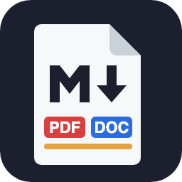
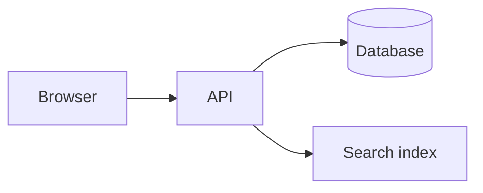

# Release notes 2.4

This sample shows what an export keeps. Click the export button in the editor title bar, or press Cmd+Alt+E (Ctrl+Alt+E on Windows and Linux), and pick PDF, Word or HTML.



## What changed

| Area | Change | Ticket |
|---|---|---|
| Search | Results load 3 times faster | #812 |
| Export | CSV files keep their column order | #799 |
| Login | Sessions last 30 days | #765 |

- [x] Faster search
- [x] Stable CSV columns
- [ ] Dark mode for the admin pages

## Upgrade

```bash
npm install our-app@2.4.0
npm run migrate
```

```js
// The new option is off by default
const app = createApp({ keepColumnOrder: true });
```

## How a request flows



## The numbers

Average load time fell from $t_1 = 1.8$ s to $t_2 = 0.6$ s, a speed-up of

$$
\frac{t_1}{t_2} = \frac{1.8}{0.6} = 3
$$

The search change was measured on 10,000 queries.[^1]

[^1]: Median of three runs on the staging server.
